# STM32 Embedded Systems Training

Fifteen STM32 programs written and run on a training kit during a one-month hands-on course (7 September to 7 October 2026) for fourth-year ECE students at Acropolis Institute of Technology & Research, Indore. The course was conducted by Mr. Rajesh Murthy, founder of Contrive Technologies.

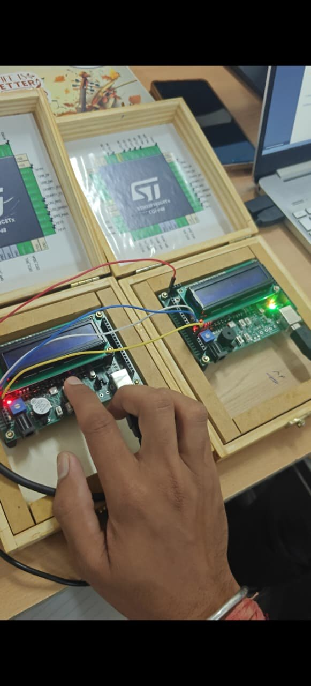

## About

The programs cover the basics of the STM32F103 using STM32CubeIDE and STM32CubeMX with the HAL library: GPIO, timers and PWM, ADC with DMA, UART, SPI, I2C, RS485 with Modbus, FreeRTOS, and a bit-banged WS2812 LED. The project setup (clock, pins, peripheral initialisation) was generated with CubeMX. I wrote the application code for each program myself and ran it on the kit.

## Programs

| # | Program | Topic |
|---|---|---|
| 01 | [LED and buzzer with a push button](projects/01-led-buzzer-key) | GPIO input and output |
| 02 | [16x2 LCD driver with keys and UART](projects/02-lcd-keys-uart) | Bit-banged LCD, UART transmit |
| 03 | [UART receive with interrupt](projects/03-uart-rx-interrupt) | UART interrupt and callback |
| 04 | [Multiplication table over UART](projects/04-uart-multiplication-table) | UART receive, `sprintf` |
| 05 | [Timer interrupt blink](projects/05-timer-interrupt-blink) | TIM1 interrupt |
| 06 | [Two timers and a software clock](projects/06-two-timers-clock) | TIM1 and TIM2, UART |
| 07 | [PWM brightness ramp](projects/07-pwm-ramp) | TIM1 PWM |
| 08 | [ADC voltage on LCD and UART](projects/08-adc-polling-lcd) | ADC polling |
| 09 | [Two ADC channels with DMA](projects/09-adc-dma-two-channels) | ADC scan and DMA |
| 10 | [SPI master](projects/10-spi-master) | SPI master, software chip select |
| 11 | [DS1307 RTC and I2C EEPROM](projects/11-ds1307-rtc-eeprom) | I2C, RTC, EEPROM |
| 12 | [RS485 Modbus RTU master](projects/12-rs485-modbus-master) | RS485, Modbus, CRC-16 |
| 13 | [FreeRTOS: two LED tasks](projects/13-freertos-two-tasks) | FreeRTOS tasks |
| 14 | [FreeRTOS: two tasks writing to the LCD](projects/14-freertos-lcd-counters) | FreeRTOS, semaphore |
| 15 | [WS2812 RGB LED](projects/15-ws2812-rgb-led) | Bit-banged protocol |

Each folder has a README with what the program does, the pins taken from the CubeMX configuration, and how to test it.

## The kit

The kit is a board with an STM32F103 (LQFP48), a 16x2 LCD, a buzzer, LEDs, push buttons and a USB connector, shown in a wooden case with the chip's pin diagram on the lid. Details: [`docs/kit.md`](docs/kit.md).

| CubeMX and the kit | CubeIDE and the kit |
|---|---|
|  | 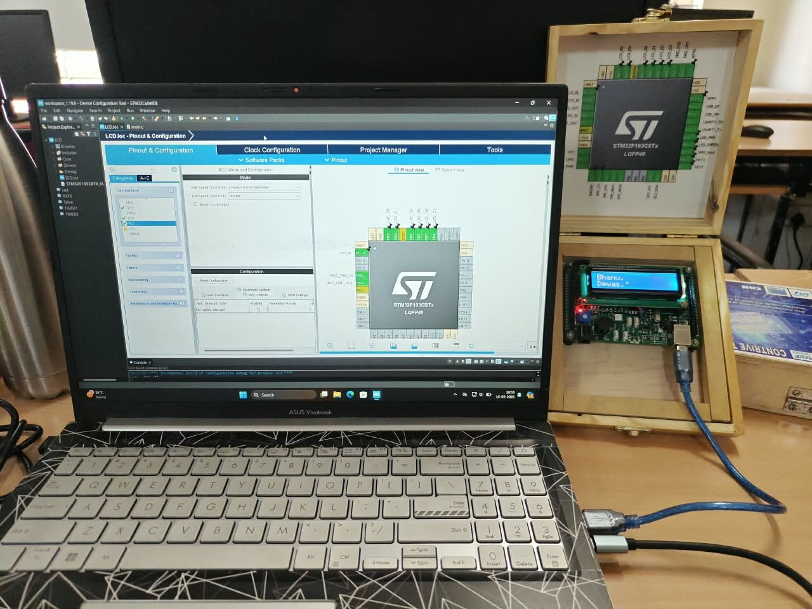 |

## Training sessions

| Lab session | Classroom |
|---|---|
| 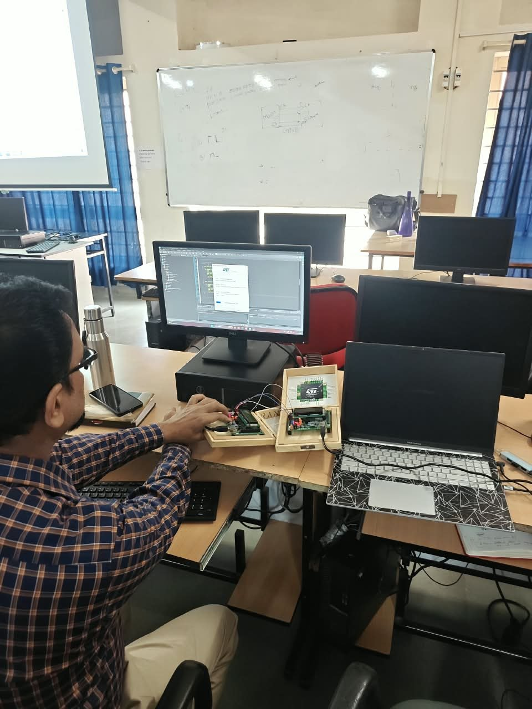 | 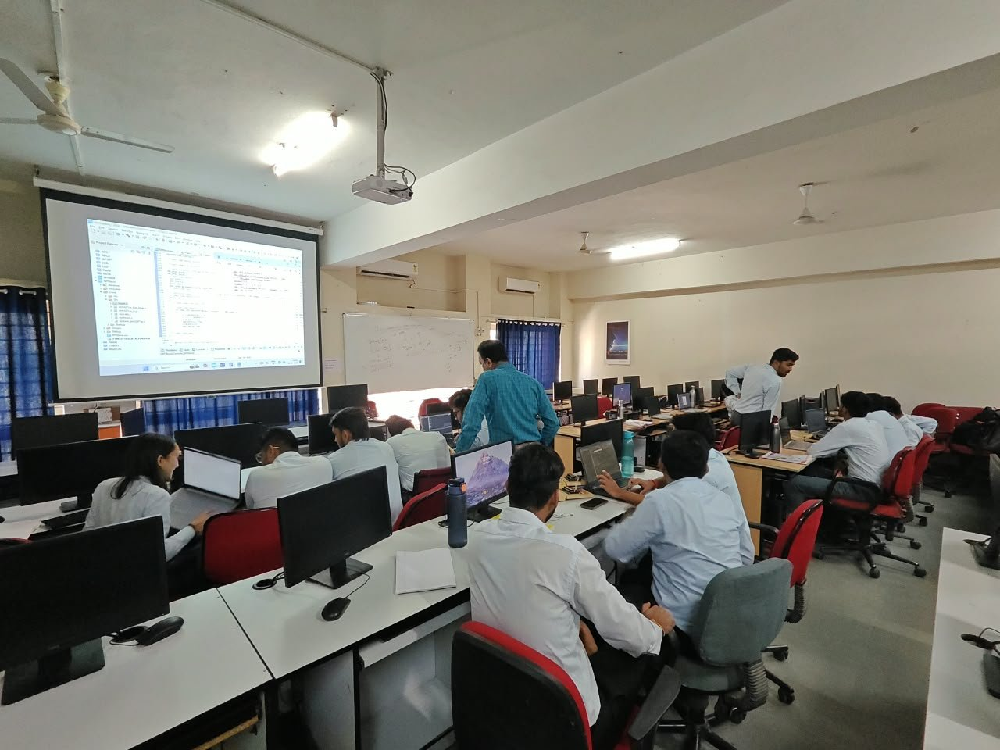 |

## Demo videos

Short clips from the training. They are not tied to one specific program. Click a title to play the full clip.

| | | |
|---|---|---|
| 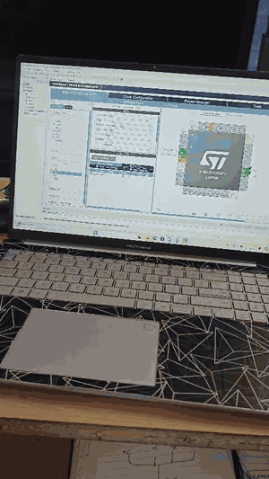 | 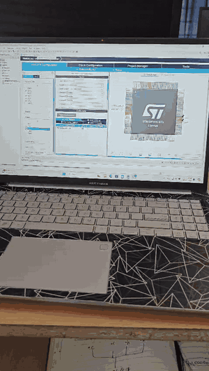 | 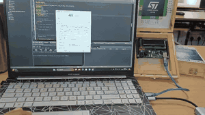 |
| [1. CubeMX on the laptop, then the kit running a program](media/videos/demo-01.mp4) | [2. The kit running next to the laptop in the lab](media/videos/demo-02.mp4) | [3. Programming the board from STM32CubeIDE, then the LCD shows text](media/videos/demo-03.mp4) |
| 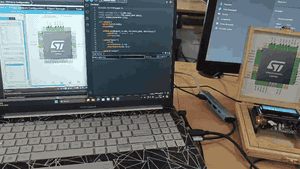 | 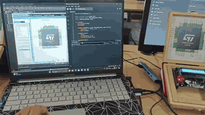 | 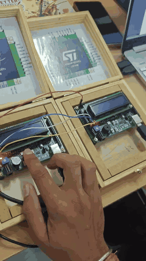 |
| [4. LCD showing the text BHANU FROM ECE](media/videos/demo-04.mp4) | [5. LCD showing the text BHANU FROM ECE (second clip)](media/videos/demo-05.mp4) | [6. Two kits wired together, pressing a key on one kit](media/videos/demo-06.mp4) |
| 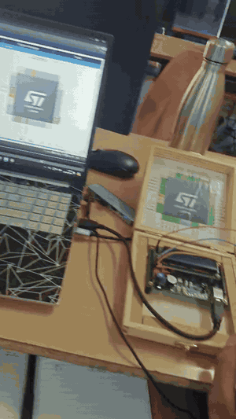 | | |
| [7. Two kits wired together (second clip)](media/videos/demo-07.mp4) | | |

## Build and run

Install STM32CubeIDE, import a project folder, and generate the code from its `.ioc` file to restore the HAL drivers. Steps: [`docs/getting-started.md`](docs/getting-started.md).

## Notes

- Programs 10 (SPI) and 12 (RS485) are the master side. The slave programs are not part of this repository.
- The CubeMX target is `STM32F103C8Tx` for programs 08 and 12, and `STM32F103CBTx` for the others. The lid of the kit shows `STM32F103C8Tx`.
- The HAL drivers and FreeRTOS middleware are not stored here. They are restored by CubeMX.

## License

My application code is under the [MIT License](LICENSE). Files generated by STM32CubeMX and the STM32 HAL carry the STMicroelectronics license headers and remain under their own terms.
