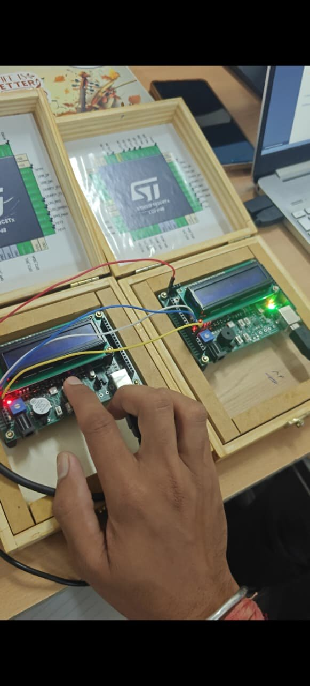
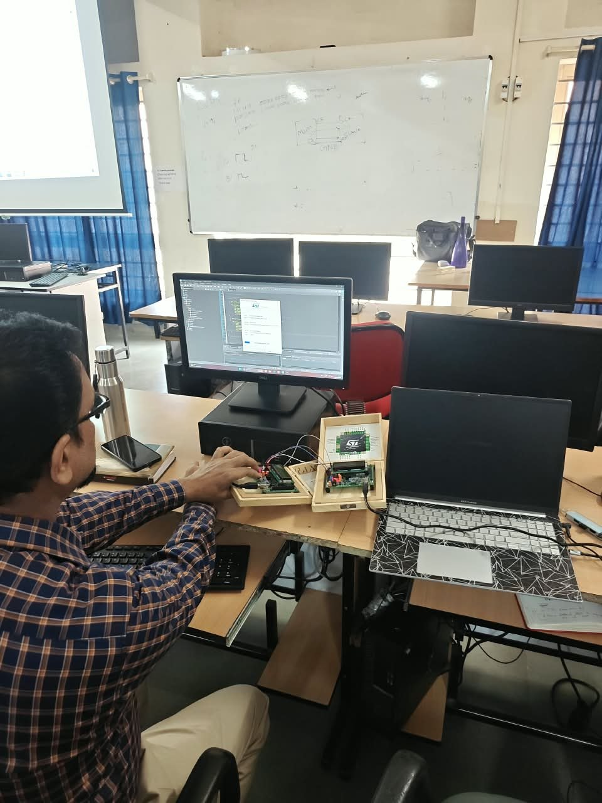

# The training kit

What can be seen in the photos of the kit:

- A board with an STM32F103 microcontroller in an LQFP48 package. The pin diagram on the lid of the case is labelled `STM32F103C8Tx`.
- A 16x2 character LCD
- A buzzer and LEDs (red and green indicators are visible)
- Push buttons (used as KEY1 and KEY2 in the programs) and a trimmer potentiometer
- A USB connector
- Two kits can be wired together for communication exercises, as in the photo below

The pin labels used in each program come from its CubeMX `.ioc` file and are listed in that project's README.

