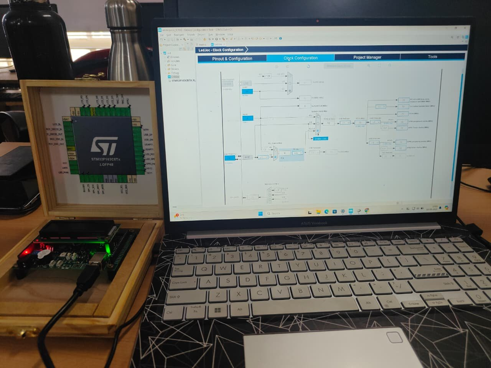

# LED and buzzer with a push button

Reads the push button KEY1 (active low). While KEY1 is pressed the LED and the buzzer are switched on, otherwise both are off. The input is polled every 100 ms.

Demo clips from the training are in the [main README](../../README.md#demo-videos).

## What it demonstrates

- GPIO output (LED, buzzer)
- GPIO input (push button, active low)
- `HAL_Delay` polling loop

## Setup

- Project name in STM32CubeIDE: `Led`
- CubeMX target: `STM32F103CBTx`
- The project was configured with STM32CubeMX and uses the STM32 HAL

## Pins (from the CubeMX configuration)

| Pin | Label | Function |
|---|---|---|
| PA3 | BUZZ | Output |
| PA8 | LED | Output |
| PB12 | KEY2 | Input |
| PB13 | KEY1 | Input |
| PB15 | LED2 | Output |

## How to test

1. Flash the program and press KEY1: the LED lights and the buzzer sounds while it is held.

## Build

See [`docs/getting-started.md`](../../docs/getting-started.md). The HAL drivers are not stored in this repository: open the `.ioc` file and generate the code to restore them.
